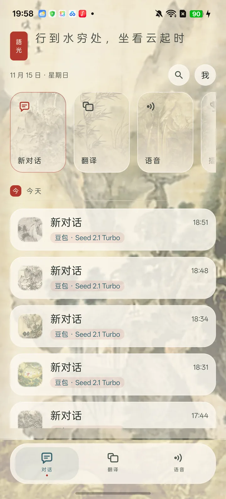
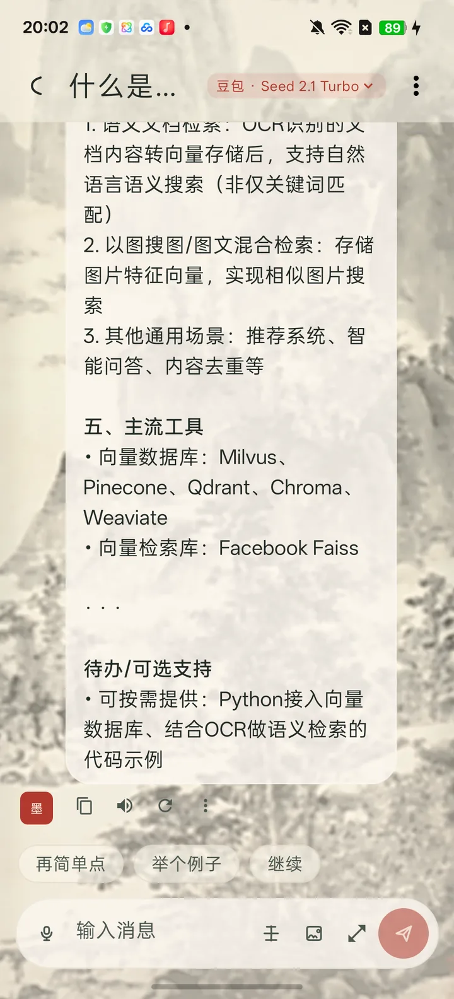
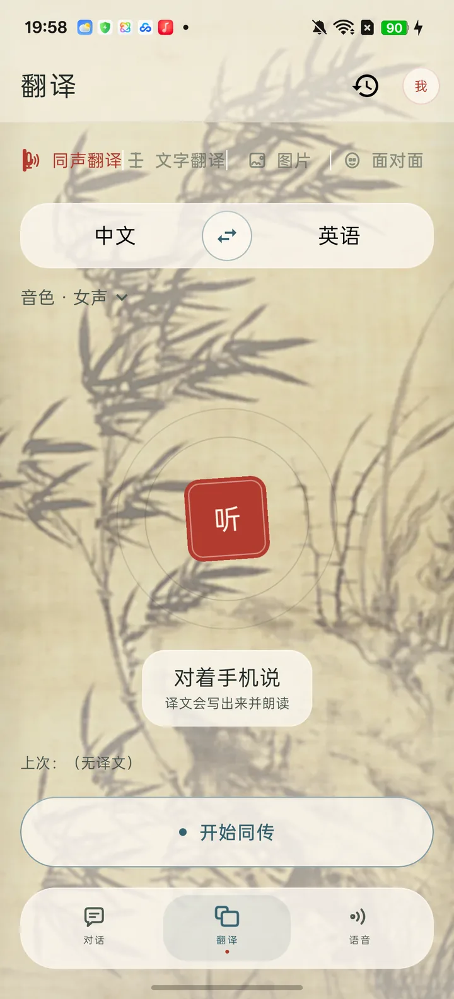
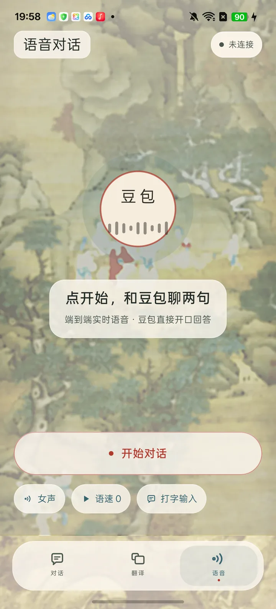
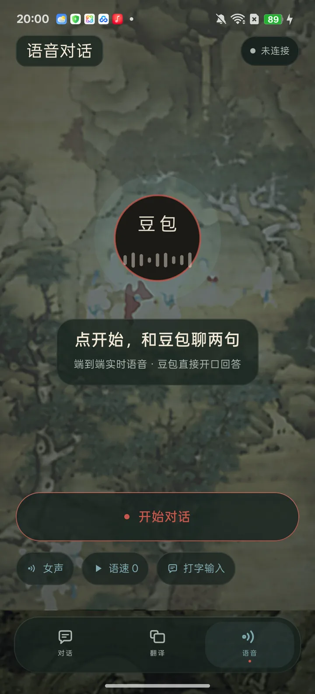
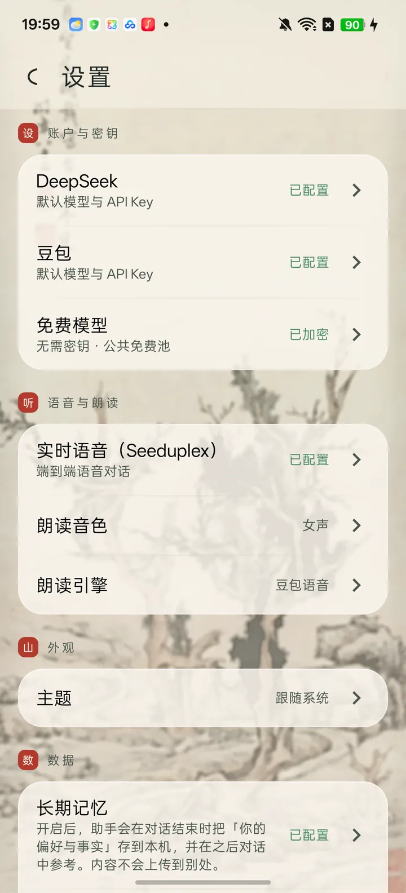
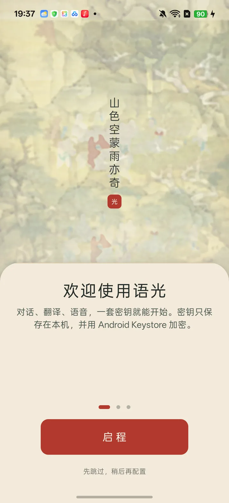
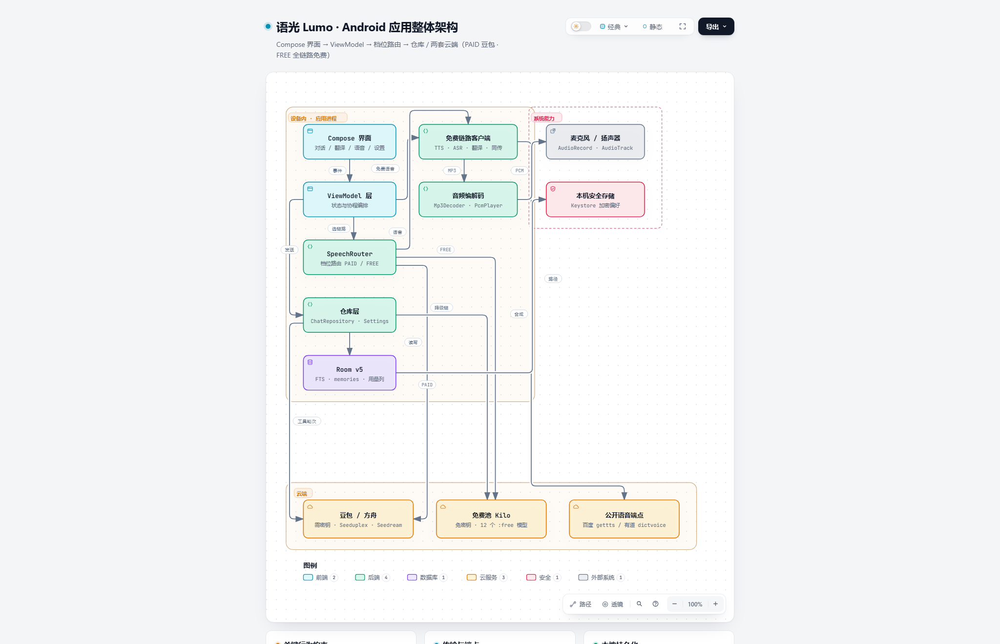

# 语光 · Lumo


Android 上的 AI 助手：和 DeepSeek、豆包（火山方舟）对话，做文字翻译与同声传译，还能直接和豆包**实时语音聊天**。三条主线共用一套本地加密的密钥即可开始。

`Android 7.0+` · `Kotlin 2.4` · `Jetpack Compose` · `Material 3` · `MIT`

- 包名：`com.yuguang.lumo`
- 版本：`1.1 (versionCode 2)`

---

## 界面预览

| 对话首页 | 聊天 | 翻译 |
|---|---|---|
|  |  |  |

| 实时语音（浅色） | 实时语音（深色） | 设置 |
|---|---|---|
|  |  |  |

| 语音聆听中 | 首次引导 |
|---|---|
|  |  |

底部三个 Tab：**对话 / 翻译 / 语音**，右上角头像进入设置。语音页与所有页面一样跟随系统深色模式。

---

## 架构与流程图

六张交互图都可以在浏览器里缩放、拖动并查看节点详情；也可以从 [图集索引](https://devwangxiaogang.github.io/Lumo/diagrams/) 进入。

| 图 | 说明 |
|---|---|
| <a href="https://devwangxiaogang.github.io/Lumo/diagrams/lumo-architecture.html"></a> | 整体架构：Compose 界面 → ViewModel → 档位路由（PAID 豆包 / FREE 全链路免费）→ 仓库 → Room v5 与两套云端，含设备内、系统能力与云端三个边界。 |
| <a href="https://devwangxiaogang.github.io/Lumo/diagrams/lumo-chat-sse.html"></a> | 对话时序：从输入到 SSE 增量回包、消息落库、思考折叠与生图工具回环的完整往返。 |
| <a href="https://devwangxiaogang.github.io/Lumo/diagrams/lumo-realtime-voice.html"></a> | 语音时序：从建连鉴权到音频上下行，再到超时与异常降级的完整往返。 |
| <a href="https://devwangxiaogang.github.io/Lumo/diagrams/lumo-voice-states.html"></a> | 语音状态机：会话各状态之间的迁移条件与异常分支。 |
| <a href="https://devwangxiaogang.github.io/Lumo/diagrams/lumo-local-data.html"></a> | 本地数据流：用户输入 → Room / 媒体文件 / 加密偏好 / 模型目录缓存 → 界面与备份。 |
| <a href="https://devwangxiaogang.github.io/Lumo/diagrams/lumo-startup-keys.html"></a> | 启动与密钥：冷启动的初始化顺序、密钥读取与首次配置引导的分支。 |

---

## GitNexus 代码图谱

使用 GitNexus 分析类、函数、调用关系、依赖注入与静态执行链路。查看 [图谱说明与模块依赖图](docs/gitnexus/README.md)，或下载 [全量 JSON](docs/gitnexus/code-graph.json)、[GraphML](docs/gitnexus/code-graph.graphml) 和 [Mermaid 模块图](docs/gitnexus/modules.mmd)。GraphML 可导入 Gephi、Cytoscape、yEd 等工具。

当前索引（1.1）：**4283 节点、7759 条关系、110 个聚类、321 条静态执行流**，覆盖 21 个 Kotlin 包与 75 条跨包依赖。本轮新增的 `data/remote/free`（免费链路）、`data/audio`（MP3 解码）、`ui/components`（档位徽章）已计入模块图。

### 启动本机浏览服务

需要 Node.js / npm 和 GitNexus CLI。本次图谱使用 GitNexus **1.6.12** 生成。以下命令均在项目根目录执行，适用于 PowerShell；`npx` 会优先使用已安装的 GitNexus，未安装时可能提示下载。

首次使用或修改代码后，先建立或更新索引：

```powershell
npx gitnexus analyze . --index-only --name Lumo
```

索引完成后启动浏览服务：

```powershell
npx gitnexus serve --host 127.0.0.1 --port 4747
```

保持终端运行，在浏览器打开 **[本机 GitNexus](http://127.0.0.1:4747/)**，从仓库列表中选择 **Lumo**，即可搜索符号、查看依赖和执行链路。已有索引时可直接启动服务，无需每次重新分析。

- `127.0.0.1` 仅供当前电脑访问；本机链接需要先启动服务。
- 在运行服务的终端按 **Ctrl+C** 停止服务。
- 若提示 `4747` 端口被占用，先打开上述地址检查是否已有 GitNexus 服务；也可改用 `--port 4748`，并访问对应端口。
- 本地索引位于 `.gitnexus/`，已加入 Git 忽略规则；新克隆项目后需要重新建立索引。

### 更新导出文件

更新索引并启动本机服务后，在另一个终端的项目根目录执行：

```powershell
node docs/gitnexus/export-graph.mjs
```

脚本会更新 `docs/gitnexus/` 中的图谱说明、JSON、GraphML 和 Mermaid 文件。若服务使用其他端口，可指定地址：

```powershell
node docs/gitnexus/export-graph.mjs http://127.0.0.1:4748
```

图谱来自静态分析，Hilt/Room 生成代码、动态分派、Compose 回调和外部 SDK 的关系可能无法完整解析；执行链路不是运行时追踪结果，缺少连线不能证明不存在依赖。

---

## 功能

### AI 对话

- 多段对话保存在本机（Room），首页支持搜索、置顶、长按重命名 / 删除、快捷入口（新对话 / 翻译 / 语音 / 备份）。
- 流式回复；助手消息可展开思考过程，支持轻量 Markdown（代码块、列表、链接），可长按复制整段消息。
- 顶栏可编辑**助手人设**（系统提示词），内置预设或自定义，保存后从下一条消息生效。
- 模型按服务商分组选择，可从服务商**拉取最新模型目录**（本地缓存约 24 小时）；目录外模型 ID 可手动填写。
- 同一对话中途不换服务商；换模型只影响下一条消息。新建对话沿用最近一次成功发送的模型。
- 消息操作：复制、朗读、重试；快捷追问（再简单点 / 举个例子 / 继续）；新消息自动滚动跟随。
- 每条助手消息可查看 token 用量，会话级用量面板显示输入/输出/合计与估算费用（免费档恒 ¥0.00）。
- 免费档对话可切换「深度思考」；免费池的思考与正文共享输出额度，默认关闭。
- 会话可导出为 Markdown 或单文件 HTML（图片内联，浏览器可直接打印成 PDF）。
- **分享入口**：任意 App 分享文字/图片，或在选中文字后用「语光」处理，都会新建会话并预填内容（不会自动发送）。
- **全文检索**：搜索框同时检索标题与消息正文；中文走子串匹配、英文走 FTS 索引并高亮片段，点结果直接进会话。
- **长期记忆**（默认关闭）：开启后助手在对话结束时提炼你的偏好与事实存到本机，后续对话自动参考。
- **本地工具**（收费档）：模型可调用 `get_time` / `calculate` / `fetch_url`（含 SSRF 防护）/ `search_my_chats`，每轮最多 3 次。

#### 识图与生图

- **发图识图**：最多 4 张，随文字发给支持视觉的模型；气泡内可点开大图。
- **AI 生图**：统一走豆包 **Seedream**（`/images/generations`），需要豆包方舟 Key（即使当前对话用 DeepSeek）。
  - 画笔画图模式：描述画面后发送，可附参考图做图生图；
  - 或输入明确画图意图（如「画一张…」）；
  - 豆包对话还会挂 `generate_image` 工具，由客户端执行并回显。
- 较新的用户附图会随上下文重放，更早的附图只保留文字，控制请求体大小。

### AI 翻译

同声翻译与文字翻译分开，记录各自保存。

- **文字翻译**：Seed Translation；输入或录音后自动翻译，也可点「翻译」立即翻译并写入记录。译文可复制、朗读；记录可回填编辑区。
- 听写输入支持按住说话、松开结束，并按文字脚本自动匹配源语言；与目标语相同则自动切换到中↔英另一侧。
- **同声翻译**：边说边出原文和译文，并由同传服务朗读译文；播放时麦克风不再回送播放声，避免重复翻译。
- 进行中不能切页或改语种；系统返回会先结束同传。
- **翻译记录**：按今天 / 昨天 / 日期分组，超过 6 条可搜索原文或译文；支持查看全文、复制、朗读、删除（删除前确认）。
- 错误提示已中文化（网络、鉴权、额度、模型不可用等）。

### 实时语音对话（Seeduplex）

- 接入豆包**端到端实时语音** `wss://openspeech.bytedance.com/api/v3/duplex/realtime/dialogue`，豆包直接语音回答，无需先识别再合成。
- **按住说话、松手发送**；播报中按住可直接打断当前回答。
- 中央光球随麦克风 / 播放音量律动，状态在待机 / 连接中 / 聆听 / 思考 / 播报之间切换。
- 实时字幕：你说 / 豆包两张卡片，最新一句高亮，长按复制。
- 通话计时；右上角红色「结束」按钮。
- **音色 / 语速热切换**：会话中修改通过 `session.update` 立即生效，不重连。
- **打字输入**：打招呼文字可直接让豆包朗读；配合实时语音会话使用。
- **自动降级**：未开通、403、网络异常或权限缺失时，自动切换为「识别 → 对话 → 朗读」链路，并在顶部显示黄色提示条。
- 底部导航是 Tab 语义：无返回箭头；系统返回键在通话中先挂断，未通话时离开语音 Tab。

### 朗读

- 对话、翻译与翻译记录可选择**豆包语音**或**本机朗读**；豆包语音可选女声 / 男声。
- 同声翻译的音色单独设置，不走全局朗读设置。
- 豆包朗读失败时，可对这一次改用本机朗读。

### 主题与外观

- 跟随系统 / 浅色 / 深色，设置内即时生效，所有页面同步。
- 统一设计令牌（颜色、圆角、字体、间距），语音页也随主题切换（浅色暖白 + 靛紫光晕，深色深空蓝 + 靛紫光晕）。

### 数据、备份与隐私

- 会话、消息、图片附件、翻译记录保存在本机 Room 数据库。
- 会话备份：导出 ZIP（含图片）、导入恢复；数据库迁移版本 v2 → v3 → v4。
- API Key 使用 Android Keystore 加密保存在本机，不写入源码、不上传第三方。
- 权限：`INTERNET`、`RECORD_AUDIO`；选图使用系统照片选择器，无需存储权限。

### 首次引导

首次启动进入引导页，可填写三个密钥（也可先跳过，稍后在设置里填写）；引导完成后不再出现。

---

## 免费链路（全链路无需密钥）

设置 → 语音与朗读 → **免费链路** 一档，是 1.1 新增的第二套完整实现：对话、翻译、朗读、识别、同传全部走公开免费接口，不需要任何 Key。收费档（豆包 / 方舟）行为与 1.0 完全一致，两套用档位卡 + 顶栏「免费」胶囊明确区分。

| 能力 | 免费实现 | 边界 |
|---|---|---|
| 对话 | Kilo 公共免费池 `https://ai-gateway.kilo.ai/api/v1` | 12 个 `:free` 模型；429 / 模型下线自动降级到下一个；思考默认关闭 |
| 文字翻译 | 免费池大模型直译 → MyMemory 兜底 | 仅 中/英/日/韩/俄 |
| 朗读 | 百度 `gettts` → 有道 `dictvoice` → 本机 TTS | 仅 5 语种；单块 ≤400 字；MP3 本地解码 |
| 语音识别 | 系统识别器 → 免费池 omni 模型（`input_audio`） | **试验级**，准确率明显低于豆包 |
| 同传 | VAD 分段 → 识别 → 翻译 → 朗读 流水线 | 约 3–9 秒延迟，非端到端实时 |
| 语音对话 | 逐轮「按住说话 → 识别 → 对话 → 朗读」 | 无 Seeduplex 级实时 |
| 生图 / 复刻原声 | 不支持 | 界面置灰并说明 |

**注意**：免费车道全部是公开网页/公共网关接口，可能被限速，请求可能被上游记录用于改进服务，请勿发送敏感内容。默认档位仍是收费档，升级后老用户体验不变。

### 一键自检

设置 → 语音与朗读 → 免费链路 → **自检免费链路**，依次探测「对话模型 / 翻译 / 朗读」三个部件，各自显示 ✓/✕ 与耗时。目的是在一处看完哪一环不通，而不是逐页试错。

### 关于本地免费模型插件

免费对话车道的能力边界参考了本机 `dsh-our-free-model` 插件（v2.8.3）的免费车道事实：Kilo 网关地址、`isFree` 清单过滤、`reasoning.enabled` 思考开关、`stream_options.include_usage` 用量帧、正文增量前降级的 fallback 语义。未移植其 OpenCode Zen 车道——那条链路要求铸造 session / project id 并重写整段官方系统提示与工具名，实测直连 429，耦合过重；同类需求用「自定义端点」覆盖。

### 自定义端点

设置 → 账户与密钥 → **自定义端点** 可填任意 OpenAI 兼容 Base URL（例如同网段的桌面端转发口 `http://192.168.1.10:18899/v1`）。Key 可选，回环与私有网段允许明文 HTTP。

---

## 服务商与密钥

| 服务商 | 默认地址 | 用途 |
|---|---|---|
| DeepSeek | `https://api.deepseek.com` | 对话（DeepSeek 模型），部分模型支持识图 |
| 豆包（火山方舟） | `https://ark.cn-beijing.volces.com/api/v3` | 对话、模型目录、Seed Translation、Seedream 生图 |
| 豆包语音 | 豆包语音控制台 | 语音识别、同声传译、朗读、实时语音对话（Seeduplex） |
| 免费模型 | `https://ai-gateway.kilo.ai/api/v1` | 免密钥对话（12 个免费模型） |
| 自定义端点 | 自填 | 任意 OpenAI 兼容服务 |

- 豆包语音支持新版 `X-Api-Key`，也兼容旧版 **AppID + Access Token** 鉴权（朗读 / 同传 / 识别）。
- 实时语音对话（Seeduplex）优先用 `X-Api-Key`；只有没填 API Key 时才走旧版 AppID + Access Token（`X-Api-App-ID` / `X-Api-Access-Key` / `X-Api-Resource-Id: volc.speech.dialog`）。
- 实时语音需要账号开通 Seeduplex；未开通或 10 秒内建连失败时，应用会给出提示并自动降级为「按住说话」。
- 免费模型与自定义端点不校验 Key；没有任何密钥时，新建对话默认用 `FREE/kilo-auto/free`。

---

## 快速开始

### 环境

- Android 7.0（API 24）及以上
- JDK 17
- Android SDK：`compileSdk` / `targetSdk` 37
- 构建链：AGP 9.4、Gradle 9.6、Kotlin 2.4.10、Compose BOM 2026.09.00

### 构建与安装

```bash
./gradlew :app:assembleDebug        # Windows 使用 gradlew.bat
./gradlew :app:testDebugUnitTest    # 单元测试
adb install -r app/build/outputs/apk/debug/app-debug.apk
```

在 `local.properties` 中配置本机 SDK 路径；首次打开后按引导填写密钥，或进入「设置 → 账户与密钥」。

### 下载与运行

调试包输出在 `app/build/outputs/apk/debug/app-debug.apk`。没有配置密钥也可以浏览历史会话、翻译记录与设置，但发送消息与语音功能需要对应密钥。

---

## 架构与技术栈

单模块 MVVM：Compose UI + ViewModel + Repository，Hilt 注入，Room 本地存储，OkHttp + kotlinx.serialization 处理网络。

| 层 | 选型 |
|---|---|
| UI | Jetpack Compose、Material 3、Navigation Compose |
| 状态 | ViewModel + `StateFlow`，收藏 / 设置用 DataStore 式 StateFlow |
| 依赖注入 | Hilt 2.60 |
| 本地存储 | Room 2.8（含迁移与 schema 导出）、文件媒体存储 |
| 网络 | OkHttp 4.12（HTTP/SSE）、原生 WebSocket（Seeduplex） |
| 序列化 | kotlinx.serialization 1.9 |
| 其他 | 协程 1.10、Activity Compose 1.13、Lifecycle 2.11 |

### 目录结构

```
app/src/main/java/com/yuguang/lumo/
├── data/
│   ├── local/        # Room 数据库、DAO、迁移、媒体文件
│   ├── remote/       # DeepSeek / 方舟 / 豆包语音 / Seeduplex / SSE 解码
│   └── ...           # 仓库实现、备份、设置
├── domain/           # 领域模型与仓库接口
├── di/               # Hilt 模块
├── ui/
│   ├── chat/         # 对话页与流式渲染
│   ├── translate/    # 文字翻译、同传、翻译记录
│   ├── voice/        # 实时语音对话（光球页面）
│   ├── list/         # 对话首页
│   ├── settings/     # 设置与子页面
│   ├── onboarding/   # 首次引导
│   ├── shell/        # 底部导航与页面骨架
│   ├── theme/        # 设计令牌与主题
│   └── ...
└── MainActivity.kt
```

### 关键链路

- **对话**：`/chat/completions` SSE 流式返回，增量渲染；支持思考过程折叠。
- **实时语音**：WebSocket JSON 事件（`session.create` / `session.update` / `input_audio_buffer.append` / `commit` / `mute` / `unmute` / `speech_text_buffer.commit` / `response.cancel`），下行 base64 PCM 24k 播放，上行 16k 单声道 20ms 帧。
- **语音识别 / 同传 / 朗读**：豆包语音 HTTP / WebSocket 接口。
- **生图**：Seedream `/images/generations`。

---

## 测试

- 单元测试：10 个文件、58 个用例（SSE 解码与思考字段别名、流式渲染、协议解析、历史预算、语言规则、模型能力、档位路由、免费语种边界）。
- 仪器测试：数据库迁移 2 → 3 与 4 → 5（含 FTS 回填与触发器，真机）。

```bash
./gradlew :app:testDebugUnitTest
./gradlew :app:connectedDebugAndroidTest   # 注意：会重装应用，先备份数据
```

---

## 数据迁移说明

项目早期版本的包名是 `com.example.myapplication`，现已迁移到 `com.yuguang.lumo`。包名变化意味着应用身份变化：

- 旧版本的本地数据不会自动出现在新包中；
- 迁移方式：旧版本「设置 → 数据 → 导出会话」得到 ZIP → 安装新包 → 「导入会话」恢复；
- API Key 用 Android Keystore 加密且与应用身份绑定，**无法迁移**，需要在设置中重新填写。

---

## 已知限制

- 方舟与豆包语音的模型 / 接口能力取决于账号开通情况；未开通时实时语音会降级，对话与翻译会给出中文错误提示。
- 同传与复刻原声的语言组合有限制：源语言或目标语言需包含中文或英文；复刻原声支持中、英、德、法、西、印尼、日、葡；粤语和上海话只能作为源语言。
- 同声翻译进行中不能切换页面或语种。
- 纯生图（Seedream）模型不会出现在对话模型选择列表中。

---

## 许可

[MIT License](LICENSE)

---

# 语光 · Lumo (English)

An Android AI assistant: chat with DeepSeek and Doubao (Volcengine Ark), translate typed text and live speech, and talk to Doubao over **end-to-end realtime voice**. Everything runs from one set of locally encrypted API keys.

`Android 7.0+` · `Kotlin 2.4` · `Jetpack Compose` · `Material 3` · `MIT`

- Package: `com.yuguang.lumo`
- Version: `1.1 (versionCode 2)`

## Preview

| Home | Chat | Translate |
|---|---|---|
|  |  |  |

| Realtime voice (light) | Realtime voice (dark) | Settings |
|---|---|---|
|  |  |  |

## Features

### Two tiers: paid (Doubao) and free

A **speech tier** switch keeps the two implementations apart. `PAID` is the 1.0 behaviour, unchanged, and needs Doubao/Ark keys. `FREE` runs the whole pipeline — chat, translation, speech, recognition, live interpretation — on public free endpoints with no key at all. The paid tier's UI is untouched; the free tier is marked with a tier card, a header badge, and inline capability notes.

| Capability | Free implementation | Limits |
|---|---|---|
| Chat | Kilo public free pool (`ai-gateway.kilo.ai`) | 12 `:free` models; falls back to the next model on 429 / model-removed before any answer text |
| Text translation | Free-pool LLM → MyMemory fallback | zh/en/ja/ko/ru only |
| Read-aloud | Baidu `gettts` → Youdao `dictvoice` → device TTS | 5 languages, ≤400 chars per chunk, MP3 decoded locally |
| Recognition | System recognizer → free-pool omni model (`input_audio`) | Experimental; noticeably less accurate than Doubao |
| Live interpretation | VAD segments → ASR → translate → TTS pipeline | ~3–9 s latency, not end-to-end realtime |
| Realtime voice | Turn-by-turn hold-to-talk instead of Seeduplex | No true realtime |
| Image generation / voice cloning | Not available | Disabled with an inline explanation |

The free tier uses public endpoints: it may be rate-limited and content may be logged upstream. The default tier stays `PAID`, so upgrading users see no change.

### Chat

- Local conversations (Room) with search, pinning, long-press rename/delete, and quick actions.
- Streaming replies, expandable reasoning, light Markdown, message copy / read-aloud / retry.
- Editable assistant persona (system prompt), model picker grouped by provider with a refreshable model catalog.
- Vision input (up to 4 images) and image generation via Doubao Seedream (draw mode, explicit intent, or a `generate_image` tool call).
- Quick follow-up chips and auto-scroll to new messages.
- Per-message token usage and an estimated cost panel (free tier always ¥0.00).
- Deep-thinking toggle for free-tier conversations (reasoning shares the output budget there).
- Export a conversation as Markdown or a self-contained HTML file (images inlined, printable to PDF).
- Incoming share: `SEND` (text/images) and `PROCESS_TEXT` pre-fill a new chat or jump to Translate — never auto-sends.
- Full-text search across message bodies (FTS4 for Latin queries, LIKE for CJK), jumping straight to the conversation.
- Optional long-term memory: off by default; when enabled, the assistant distils durable preferences after a turn and references them later. All local.
- Local tool registry for paid-tier models: `get_time`, `calculate`, `fetch_url` (SSRF-guarded), `search_my_chats`, up to 3 rounds per turn.

### Translation

- Seed Translation for text, Doubao simultaneous interpretation for live speech.
- Language-pair card, swap, automatic source-language matching from typed or recognized text.
- Translation records grouped by day with search, detail view, copy, read-aloud and delete.
- Microphone echo suppression while the interpreted speech is playing.

### Realtime voice (Seeduplex)

- End-to-end realtime voice over `wss://openspeech.bytedance.com/api/v3/duplex/realtime/dialogue`; Doubao answers with speech directly.
- Hold to talk, release to send; press while it is speaking to interrupt.
- Central orb reacts to microphone and playback levels; live captions for both sides.
- Call timer, red end button, and a Tab-style back behaviour (back ends the call first).
- Hot voice / speed switching during a call via `session.update`, no reconnect needed.
- Text greeting input, and automatic fallback to ASR → LLM → TTS when realtime voice is unavailable.

### Read-aloud

- Doubao TTS or the system TTS engine, with female / male voices for Doubao; a failed Doubao read can fall back to the system engine for that message.

### Theme & data

- System / light / dark theme applied to every screen, including the voice page.
- Session backup ZIP export / import (images included); Room migrations v2 → v3 → v4.
- API keys encrypted with Android Keystore and never committed.

## Providers

| Provider | Default endpoint | Used for |
|---|---|---|
| DeepSeek | `https://api.deepseek.com` | Chat (DeepSeek models), vision on supported models |
| Doubao (Ark) | `https://ark.cn-beijing.volces.com/api/v3` | Chat, model catalog, Seed Translation, Seedream images |
| Doubao Speech | Doubao Speech console | ASR, simultaneous interpretation, TTS, realtime voice (Seeduplex) |

## Build

```bash
./gradlew :app:assembleDebug
./gradlew :app:testDebugUnitTest
adb install -r app/build/outputs/apk/debug/app-debug.apk
```

Requires JDK 17 and Android SDK with compileSdk/targetSdk 37. Configure keys on first launch or under Settings → Account & keys.

## Architecture

Single-module MVVM: Compose UI + ViewModel + Repository, Hilt, Room, OkHttp + kotlinx.serialization. Modules: `data/local` (Room), `data/remote` (DeepSeek, Ark, Doubao Speech, Seeduplex, SSE), `domain`, `di`, `ui/{chat,translate,voice,list,settings,onboarding,shell,theme}`.

## GitNexus code graph

Use GitNexus to explore classes, functions, calls, dependency injection, and static execution flows. Read the [graph guide and module dependencies](docs/gitnexus/README.md), or download the [full JSON](docs/gitnexus/code-graph.json), [GraphML](docs/gitnexus/code-graph.graphml), and [Mermaid module graph](docs/gitnexus/modules.mmd). GraphML can be imported into tools such as Gephi, Cytoscape, and yEd.

Current index (1.1): **4283 nodes, 7759 relationships, 110 clusters, 321 static execution flows**, covering 21 Kotlin packages and 75 cross-package dependencies. The new `data/remote/free` (free lane), `data/audio` (MP3 decoding), and `ui/components` (tier badge) packages are included in the module graph.

### Start the local viewer

Requires Node.js / npm and the GitNexus CLI. This graph was generated with GitNexus **1.6.12**. Run all commands below from the project root; they work in PowerShell. `npx` uses an installed GitNexus when available and may prompt to download it otherwise.

On first use, or after changing the code, create or update the index:

```powershell
npx gitnexus analyze . --index-only --name Lumo
```

Once indexing finishes, start the viewer:

```powershell
npx gitnexus serve --host 127.0.0.1 --port 4747
```

Keep the terminal running, open **[local GitNexus](http://127.0.0.1:4747/)** in your browser, and select **Lumo** from the repository list to search symbols and explore dependencies and execution flows. If an index already exists, you can start the viewer directly without analyzing the project again.

- `127.0.0.1` allows access only from the current computer. Start the service before opening the local link.
- Press **Ctrl+C** in the terminal running the service to stop it.
- If port `4747` is occupied, open the address above to check for an existing GitNexus service. Alternatively, use `--port 4748` and open that port in your browser.
- The local index lives in `.gitnexus/` and is ignored by Git. Create a new index after cloning the project.

### Refresh the exports

After updating the index and starting the local service, open another terminal at the project root and run:

```powershell
node docs/gitnexus/export-graph.mjs
```

The script updates the graph guide, JSON, GraphML, and Mermaid files in `docs/gitnexus/`. If the service uses a different port, pass its address:

```powershell
node docs/gitnexus/export-graph.mjs http://127.0.0.1:4748
```

The graph comes from static analysis. Relationships involving Hilt/Room generated code, dynamic dispatch, Compose callbacks, and external SDKs may be incomplete. Execution flows are not runtime traces, and a missing edge does not prove that no dependency exists.

## Testing

- 10 unit-test files / 58 cases (SSE decoding incl. reasoning aliases, streaming overlay, wire protocol, history budget, language rules, model capabilities, tier routing, free-tier language limits).
- Instrumented migration tests 2 → 3 and 4 → 5 (FTS backfill and triggers).

```bash
./gradlew :app:testDebugUnitTest
./gradlew :app:connectedDebugAndroidTest   # reinstalls the app; back up data first
```

## Migration note

Earlier builds used `com.example.myapplication`; the app is now `com.yuguang.lumo`. Local data does not transfer automatically — export a backup ZIP from the old build and import it into the new one. API keys are bound to the app identity via Android Keystore and must be entered again.

## Limitations

- Provider features depend on your account's access; unavailable realtime voice falls back automatically.
- Simultaneous interpretation and voice cloning support a limited set of language combinations (source or target must include Chinese or English).
- Pure image-generation models are hidden from the chat model picker.

## License

[MIT](LICENSE)
