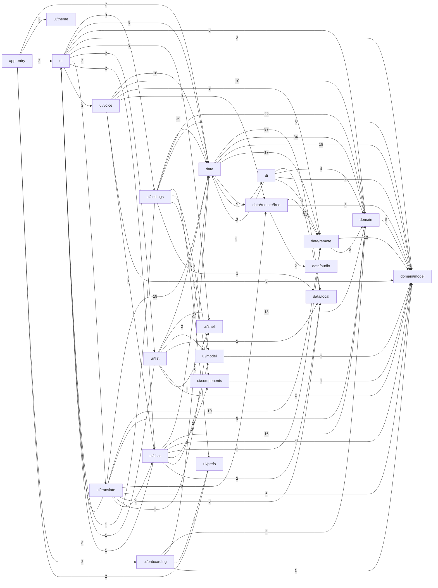

# 语光 Lumo · GitNexus 代码图谱

生成时间：2026-11-15 02:09:15（Asia/Shanghai）

索引提交：`738cf1e04a967330ebcc973238c4d766e7875450`。数据来自 GitNexus 本地索引，未导出源码正文。

图谱共 **4283 个节点、7759 条关系、110 个聚类、321 条静态执行流**。文件、目录、文档节点也包含在全量计数中，不能将节点总数视作代码符号数。

## 打开图谱

- [GitNexus 交互图谱](http://127.0.0.1:4747/?project=Lumo&repo=D%3A%5ClocalProgram%5CAIdemo)：搜索符号、查看依赖和执行流。需要本机 GitNexus 服务运行。
- [全量 JSON](code-graph.json)：GitNexus 原始节点和关系，保留路径、行号、置信度与分析原因等字段。
- [GraphML](code-graph.graphml)：可导入 Gephi、Cytoscape、yEd 等图工具。
- [模块依赖 Mermaid 源文件](modules.mmd)：只汇总主代码 Kotlin 包之间的关系。

## 主代码模块关系

箭头由依赖方指向被依赖方；数字为跨包 CALLS / IMPORTS / EXTENDS / IMPLEMENTS / INJECTS 关系数，包含不同类型的关系，不能解读为运行时调用次数。同一文件中不重复绘制类和函数节点。



## 节点类型

| 类型 | 数量 |
|---|---:|
| Property | 1872 |
| Method | 1340 |
| Process | 321 |
| Class | 204 |
| Function | 132 |
| File | 121 |
| Community | 110 |
| Enum | 63 |
| Folder | 51 |
| Section | 50 |
| Interface | 19 |

## 关系类型

| 关系 | 数量 |
|---|---:|
| DEFINES | 1466 |
| STEP_IN_PROCESS | 1421 |
| HAS_METHOD | 1339 |
| CALLS | 938 |
| HAS_PROPERTY | 825 |
| MEMBER_OF | 689 |
| ACCESSES | 525 |
| CONTAINS | 213 |
| IMPORTS | 201 |
| INJECTS | 63 |
| METHOD_IMPLEMENTS | 42 |
| IMPLEMENTS | 37 |

## 静态调用入度较高的符号

入度仅代表索引中识别到的 CALLS 关系数量，不代表运行频次，也不保证覆盖所有调用者。

- [get](../../app/src/main/java/com/yuguang/lumo/data/SettingsRepositoryImpl.kt#L31)：21 条入向调用关系；`app/src/main/java/com/yuguang/lumo/data/SettingsRepositoryImpl.kt:31`
- [get](../../app/src/main/java/com/yuguang/lumo/domain/SettingsRepository.kt#L11)：20 条入向调用关系；`app/src/main/java/com/yuguang/lumo/domain/SettingsRepository.kt:11`
- [decode](../../app/src/main/java/com/yuguang/lumo/data/remote/SseDecoder.kt#L28)：14 条入向调用关系；`app/src/main/java/com/yuguang/lumo/data/remote/SseDecoder.kt:28`
- [speech](../../app/src/main/java/com/yuguang/lumo/domain/SettingsRepository.kt#L23)：13 条入向调用关系；`app/src/main/java/com/yuguang/lumo/domain/SettingsRepository.kt:23`
- [speech](../../app/src/main/java/com/yuguang/lumo/data/SettingsRepositoryImpl.kt#L69)：13 条入向调用关系；`app/src/main/java/com/yuguang/lumo/data/SettingsRepositoryImpl.kt:69`
- [updateBody](../../app/src/main/java/com/yuguang/lumo/data/local/ChatStore.kt#L173)：12 条入向调用关系；`app/src/main/java/com/yuguang/lumo/data/local/ChatStore.kt:173`
- [chatCompletions](../../app/src/main/java/com/yuguang/lumo/data/remote/EndpointUrls.kt#L48)：10 条入向调用关系；`app/src/main/java/com/yuguang/lumo/data/remote/EndpointUrls.kt:48`
- [livePairError](../../app/src/main/java/com/yuguang/lumo/domain/model/Speech.kt#L122)：9 条入向调用关系；`app/src/main/java/com/yuguang/lumo/domain/model/Speech.kt:122`
- [inferVision](../../app/src/main/java/com/yuguang/lumo/domain/model/Models.kt#L283)：8 条入向调用关系；`app/src/main/java/com/yuguang/lumo/domain/model/Models.kt:283`
- [stop](../../app/src/main/java/com/yuguang/lumo/data/SpeechReader.kt#L113)：8 条入向调用关系；`app/src/main/java/com/yuguang/lumo/data/SpeechReader.kt:113`
- [historyStartIndex](../../app/src/main/java/com/yuguang/lumo/domain/model/HistoryWindow.kt#L10)：7 条入向调用关系；`app/src/main/java/com/yuguang/lumo/domain/model/HistoryWindow.kt:10`
- [stream](../../app/src/main/java/com/yuguang/lumo/data/remote/OpenAiCompatibleClient.kt#L31)：7 条入向调用关系；`app/src/main/java/com/yuguang/lumo/data/remote/OpenAiCompatibleClient.kt:31`
- [editSpeech](../../app/src/main/java/com/yuguang/lumo/domain/SettingsRepository.kt#L28)：7 条入向调用关系；`app/src/main/java/com/yuguang/lumo/domain/SettingsRepository.kt:28`
- [editSpeech](../../app/src/main/java/com/yuguang/lumo/data/SettingsRepositoryImpl.kt#L75)：7 条入向调用关系；`app/src/main/java/com/yuguang/lumo/data/SettingsRepositoryImpl.kt:75`
- [updateSpeech](../../app/src/main/java/com/yuguang/lumo/ui/translate/TranslateViewModel.kt#L572)：7 条入向调用关系；`app/src/main/java/com/yuguang/lumo/ui/translate/TranslateViewModel.kt:572`

## GitNexus 自动聚类

聚类名称由算法启发式生成，可能混合多个业务职责。

- **Chat**：22 个符号
- **Data**：22 个符号
- **Translate**：16 个符号
- **Voice**：16 个符号
- **Data**：15 个符号
- **Data**：15 个符号
- **Settings**：14 个符号
- **Remote**：14 个符号
- **Free**：13 个符号
- **Lumo**：13 个符号
- **List**：11 个符号
- **Settings**：11 个符号
- **Voice**：11 个符号
- **Translate**：10 个符号
- **Translate**：10 个符号
- **Data**：9 个符号
- **Lumo**：9 个符号
- **Translate**：9 个符号
- **Translate**：9 个符号
- **Data**：9 个符号

## 较长的静态执行流

这些是分析器沿静态关系识别出的候选链路，不是运行时采样记录。

- **ProviderSettingsScreen → IsLocalHost**：10 步
- **Execute → Peek**：10 步
- **Execute → Primary**：10 步
- **Execute → SkipSpaces**：10 步
- **Specs → Peek**：9 步
- **Specs → SkipSpaces**：9 步
- **ProviderSettingsScreen → ArkKeep**：8 步
- **ProviderSettingsScreen → FamilyKey**：8 步
- **ProviderSettingsScreen → InferImageGen**：8 步
- **ProviderSettingsScreen → VersionKey**：8 步
- **ProviderSettingsScreen → InferVision**：8 步
- **ProviderSettingsScreen → PrettyFreeLabel**：8 步
- **RunSelfTest → IsMissingModel**：8 步
- **RunSelfTest → IsRetryableError**：8 步
- **UpdateInput → MapCommonError**：8 步

## 覆盖范围与限制

- 全量导出覆盖 GitNexus 按忽略规则纳入的项目文件；构建产物、Gradle 缓存等不作为业务源码图谱。
- 模块图只统计 `app/src/main` 下 `com.yuguang.lumo` 包内的 Kotlin 生产代码；测试、资源和文档仍可在全量图谱中检查。
- 静态分析对 Hilt/Room 生成代码、接口动态分派、Compose 回调、协程和外部 Android SDK 的解析有限；缺少连线不能证明不存在依赖。
- 本次未启用嵌入向量、CFG/PDG 或运行时追踪；聚类和执行链均为 GitNexus 静态分析结果。

## 更新

在项目根目录重新建立索引，启动本机服务，再运行此目录的导出脚本：

```powershell
npx gitnexus analyze . --index-only --name Lumo
npx gitnexus serve --host 127.0.0.1 --port 4747
# 在另一个终端运行
node docs/gitnexus/export-graph.mjs
```

若当前环境未将 Node/npm 加入 PATH，请使用本机已安装的 Node 与 GitNexus CLI 的完整路径。
