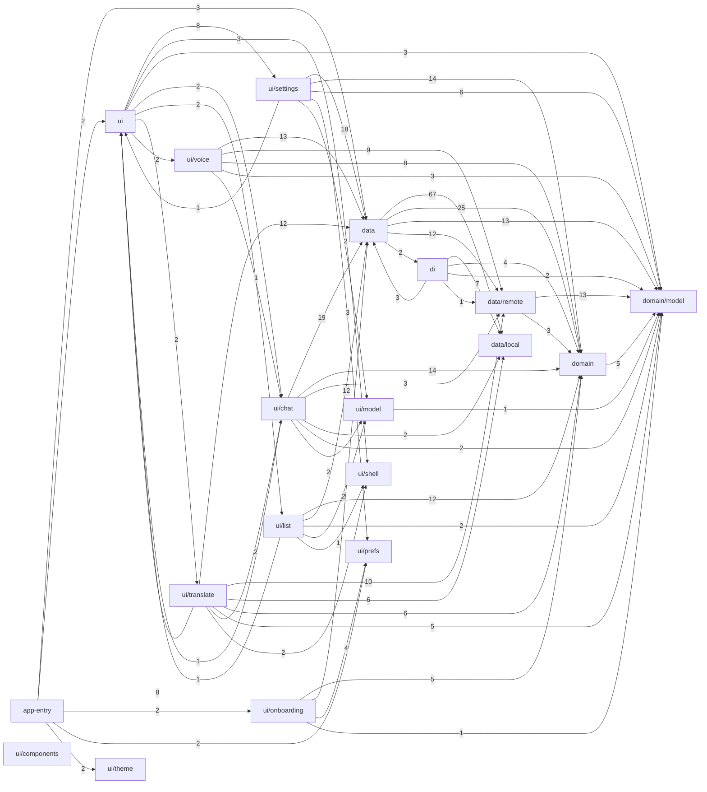

# 语光 Lumo · GitNexus 代码图谱

生成时间：2026-11-08 02:22:58（Asia/Shanghai）

索引提交：`b41020bb787a0ff7b6d192c798d4c6e52cfceabc`。数据来自 GitNexus 本地索引，未导出源码正文。

图谱共 **3140 个节点、5438 条关系、79 个聚类、198 条静态执行流**。文件、目录、文档节点也包含在全量计数中，不能将节点总数视作代码符号数。

## 打开图谱

- [GitNexus 交互图谱](http://127.0.0.1:4747/?project=Lumo&repo=D%3A%5ClocalProgram%5CAIdemo)：搜索符号、查看依赖和执行流。需要本机 GitNexus 服务运行。
- [全量 JSON](code-graph.json)：GitNexus 原始节点和关系，保留路径、行号、置信度与分析原因等字段。
- [GraphML](code-graph.graphml)：可导入 Gephi、Cytoscape、yEd 等图工具。
- [模块依赖 Mermaid 源文件](modules.mmd)：只汇总主代码 Kotlin 包之间的关系。

## 主代码模块关系

箭头由依赖方指向被依赖方；数字为跨包 CALLS / IMPORTS / EXTENDS / IMPLEMENTS / INJECTS 关系数，包含不同类型的关系，不能解读为运行时调用次数。同一文件中不重复绘制类和函数节点。



## 节点类型

| 类型 | 数量 |
|---|---:|
| Property | 1392 |
| Method | 956 |
| Process | 198 |
| Class | 156 |
| Function | 115 |
| File | 100 |
| Community | 79 |
| Folder | 49 |
| Enum | 41 |
| Section | 39 |
| Interface | 15 |

## 关系类型

| 关系 | 数量 |
|---|---:|
| DEFINES | 1108 |
| HAS_METHOD | 955 |
| STEP_IN_PROCESS | 794 |
| CALLS | 657 |
| HAS_PROPERTY | 612 |
| MEMBER_OF | 495 |
| ACCESSES | 398 |
| CONTAINS | 179 |
| IMPORTS | 141 |
| INJECTS | 36 |
| METHOD_IMPLEMENTS | 32 |
| IMPLEMENTS | 31 |

## 静态调用入度较高的符号

入度仅代表索引中识别到的 CALLS 关系数量，不代表运行频次，也不保证覆盖所有调用者。

- [get](../../app/src/main/java/com/yuguang/lumo/data/SettingsRepositoryImpl.kt#L30)：20 条入向调用关系；`app/src/main/java/com/yuguang/lumo/data/SettingsRepositoryImpl.kt:30`
- [get](../../app/src/main/java/com/yuguang/lumo/domain/SettingsRepository.kt#L11)：19 条入向调用关系；`app/src/main/java/com/yuguang/lumo/domain/SettingsRepository.kt:11`
- [updateBody](../../app/src/main/java/com/yuguang/lumo/data/local/ChatStore.kt#L157)：12 条入向调用关系；`app/src/main/java/com/yuguang/lumo/data/local/ChatStore.kt:157`
- [inferVision](../../app/src/main/java/com/yuguang/lumo/domain/model/Models.kt#L180)：8 条入向调用关系；`app/src/main/java/com/yuguang/lumo/domain/model/Models.kt:180`
- [decode](../../app/src/main/java/com/yuguang/lumo/data/remote/SseDecoder.kt#L24)：8 条入向调用关系；`app/src/main/java/com/yuguang/lumo/data/remote/SseDecoder.kt:24`
- [stop](../../app/src/main/java/com/yuguang/lumo/data/SpeechReader.kt#L109)：8 条入向调用关系；`app/src/main/java/com/yuguang/lumo/data/SpeechReader.kt:109`
- [livePairError](../../app/src/main/java/com/yuguang/lumo/domain/model/Speech.kt#L99)：7 条入向调用关系；`app/src/main/java/com/yuguang/lumo/domain/model/Speech.kt:99`
- [historyStartIndex](../../app/src/main/java/com/yuguang/lumo/domain/model/HistoryWindow.kt#L10)：7 条入向调用关系；`app/src/main/java/com/yuguang/lumo/domain/model/HistoryWindow.kt:10`
- [updateSpeech](../../app/src/main/java/com/yuguang/lumo/ui/translate/TranslateViewModel.kt#L528)：7 条入向调用关系；`app/src/main/java/com/yuguang/lumo/ui/translate/TranslateViewModel.kt:528`
- [arkKeep](../../app/src/main/java/com/yuguang/lumo/domain/model/Models.kt#L197)：7 条入向调用关系；`app/src/main/java/com/yuguang/lumo/domain/model/Models.kt:197`
- [update](../../app/src/main/java/com/yuguang/lumo/ui/settings/SettingsViewModel.kt#L84)：6 条入向调用关系；`app/src/main/java/com/yuguang/lumo/ui/settings/SettingsViewModel.kt:84`
- [speech](../../app/src/main/java/com/yuguang/lumo/domain/SettingsRepository.kt#L23)：6 条入向调用关系；`app/src/main/java/com/yuguang/lumo/domain/SettingsRepository.kt:23`
- [speech](../../app/src/main/java/com/yuguang/lumo/data/SettingsRepositoryImpl.kt#L65)：6 条入向调用关系；`app/src/main/java/com/yuguang/lumo/data/SettingsRepositoryImpl.kt:65`
- [speak](../../app/src/main/java/com/yuguang/lumo/ui/translate/TranslateViewModel.kt#L453)：5 条入向调用关系；`app/src/main/java/com/yuguang/lumo/ui/translate/TranslateViewModel.kt:453`
- [chatCompletions](../../app/src/main/java/com/yuguang/lumo/data/remote/EndpointUrls.kt#L37)：5 条入向调用关系；`app/src/main/java/com/yuguang/lumo/data/remote/EndpointUrls.kt:37`

## GitNexus 自动聚类

聚类名称由算法启发式生成，可能混合多个业务职责。

- **Data**：20 个符号
- **Chat**：18 个符号
- **Data**：18 个符号
- **Translate**：16 个符号
- **Voice**：16 个符号
- **Data**：13 个符号
- **Settings**：11 个符号
- **Voice**：11 个符号
- **Translate**：10 个符号
- **List**：10 个符号
- **Model**：10 个符号
- **Translate**：10 个符号
- **Onboarding**：9 个符号
- **Translate**：9 个符号
- **Translate**：9 个符号
- **Ui**：8 个符号
- **Translate**：8 个符号
- **Local**：8 个符号
- **Data**：8 个符号
- **Data**：7 个符号

## 较长的静态执行流

这些是分析器沿静态关系识别出的候选链路，不是运行时采样记录。

- **RefreshModels → NormalizeBaseUrl**：8 步
- **RefreshModels → ArkKeep**：7 步
- **RefreshModels → FamilyKey**：7 步
- **RefreshModels → InferImageGen**：7 步
- **RefreshModels → VersionKey**：7 步
- **RefreshModels → InferVision**：7 步
- **UpdateInput → WriteSpeech**：7 步
- **ChatScreen → SpeechChunks**：6 步
- **DataSettingsScreen → Get**：6 步
- **DataSettingsScreen → Get**：6 步
- **OnCreate → SetPinned**：6 步
- **RefreshModels → FromLabelRes**：6 步
- **UpdateInput → EditSpeech**：6 步
- **RefreshIfStale → NormalizeBaseUrl**：6 步
- **ApplyVoiceInput → WriteSpeech**：6 步

## 覆盖范围与限制

- 全量导出覆盖 GitNexus 按忽略规则纳入的项目文件；构建产物、Gradle 缓存等不作为业务源码图谱。
- 模块图只统计 `app/src/main` 下 `com.yuguang.lumo` 包内的 Kotlin 生产代码；测试、资源和文档仍可在全量图谱中检查。
- 静态分析对 Hilt/Room 生成代码、接口动态分派、Compose 回调、协程和外部 Android SDK 的解析有限；缺少连线不能证明不存在依赖。
- 本次未启用嵌入向量、CFG/PDG 或运行时追踪；聚类和执行链均为 GitNexus 静态分析结果。

## 更新

在项目根目录重新建立索引，启动本机服务，再运行此目录的导出脚本：

```powershell
npx gitnexus analyze . --index-only --name Lumo
npx gitnexus serve --host 127.0.0.1 --port 4747
# 在另一个终端运行
node docs/gitnexus/export-graph.mjs
```

若当前环境未将 Node/npm 加入 PATH，请使用本机已安装的 Node 与 GitNexus CLI 的完整路径。
